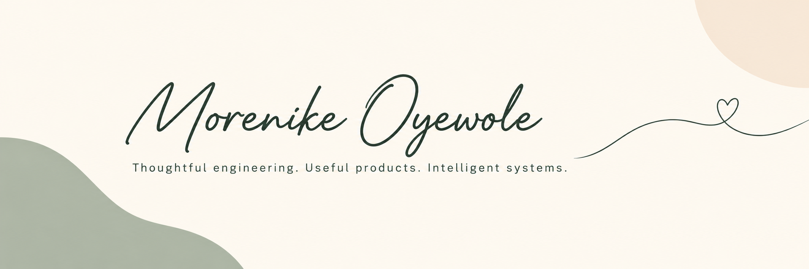

# Hello  I'm Mo

### I build tools that solve real-world problems.

With over 5 years of experience in full-stack software engineering, working with React, Next.js, TypeScript, and Node.js, I enjoy turning ideas into practical, user-focused products. I'm currently building **RateAm**, a business discovery and review platform, and **SignalFly**, an application monitoring and developer feedback platform, while exploring how AI can power more intelligent software experiences.

I'm passionate about building scalable applications, solving meaningful problems, and growing at the intersection of software engineering, AI, and product development.

Outside of work, you'll usually find me at the piano, working on a crochet project, baking something sweet, or taking care of my indoor plants. I started in music before transitioning into engineering, and that background still influences how I think. I approach software with a sense of structure, rhythm, and iteration. The best products aren't just functional; they're well put together and feel right to use.

<p align="left">
  
</p>

<p align="left">
 <a
  href="https://www.tiktok.com/@mo_renike__"
  target="_blank"
  rel="noopener noreferrer"
  aria-label="Follow Morenike on TikTok"
> Check out Morenike on TikTok!
  
</a>
</p>

[](https://holopin.io/@morenike)

```javascript
const profile = {
  name: "Morenike Oyewole",
  location: "West Africa",
  learning: ["AI Engineering", "Java"],
  building: ["RateAm", "SignalFly", "Afara"],
  interests: [
    "Software Engineering",
    "Artificial Intelligence",
    "Product Development",
    "Farming",
    "Music",
  ],
  hobbies: ["Gardening", "Playing Piano", "Painting", "Baking"],
  techStack: {
    languagesAndFrameworks: [
      "Java",
      "JavaScript (ES6+)",
      "TypeScript",
      "Node.js",
      "Express.js",
      "React",
      "Next.js",
      "Nest.js",
    ],
    databases: ["MongoDB", "PostgreSQL", "Prisma ORM"],
    frontendTools: [
      "Tailwind CSS",
      "Material UI",
      "Chakra UI",
      "Storybook",
      "Figma",
    ],
    backendAndDevOps: [
      "REST APIs",
      "GraphQL APIs",
      "Google Cloud Functions",
      "Vercel",
      "Render",
      "AWS",
      "Docker",
      "GitHub Actions",
    ],
    testingAndVersionControl: [
      "Jest",
      "React Testing Library",
      "Git",
      "GitHub Actions",
    ],
    softSkills: [
      "Ownership",
      "Problem Solving",
      "Collaboration",
      "Product Thinking",
      "Agile Workflow",
    ],
  },
};
```

---

### ✨ Current Focus

- 🔭 Working as a Full-Stack Engineer at The People Practice.
- 🚀 Building **[RateAm](https://rateam-ruby.vercel.app/)**, a platform that helps people discover businesses, explore services, and share reviews.
- 🛠️ Building **[SignalFly](https://signalfly-ai.vercel.app/)**, an application monitoring and developer feedback platform.
- 💡 Developing products that combine solid software engineering with practical AI capabilities.
- 🌱 Deepening my expertise in **AI Engineering**, **Backend Architecture**, **System Design**, and **Product Development**.
- 👯 Open to collaborations on innovative products, AI-powered applications, and impactful engineering projects.

---

### 🚀 Things I'm Building

#### [RateAm](https://rateam-ruby.vercel.app/)

A business discovery and review platform designed to help people find businesses, explore their services, and make informed decisions through customer reviews.

- 🔎 Business discovery and contextual search.
- ⭐ Business ratings and customer reviews.
- 🏢 Business profiles with services, social links, and contact information.
- 📍 Location-aware business information and public-facing pages.

**Tech stack:** Next.js, React, TypeScript, Chakra UI, Clerk, TanStack Query, Prisma, PostgreSQL, and S3 storage.

#### [SignalFly](https://signalfly-ai.vercel.app/)

An application monitoring and developer feedback platform designed to help developers monitor application health, identify incidents, and collect contextual feedback.

- 📡 Application health monitoring and automated checks.
- 🚨 Incident detection, tracking, and recovery.
- ⚙️ Background job processing and scheduled monitoring.
- 🧩 GitHub integration for connecting repositories and organizing application monitors.

**Tech stack:** Next.js, TypeScript, Node.js, NestJS, Prisma, PostgreSQL, Redis, BullMQ, and GitHub integration.

---

### 🛠️ Skills & Tools

- **Frontend:** React, Next.js, TypeScript, JavaScript, Tailwind CSS, Chakra UI
- **Backend:** Node.js, NestJS, Express.js, REST APIs, GraphQL, Java
- **Databases:** PostgreSQL, MongoDB, Prisma ORM
- **AI Engineering:** LLM-powered applications, AI integration, retrieval-based systems
- **Testing:** Jest, React Testing Library
- **Infrastructure & DevOps:** AWS, Docker, Redis, GitHub Actions, Vercel
- **Design Systems:** Storybook, Figma
- **Other Tools:** Git, Linux, AWS CLI

---

### 📝 Articles & Portfolio

- 🔗 [Explore My Portfolio](https://portfolio-mo-renike.vercel.app/) – Live demos, case studies, and more!
- 📝 Writing on [Hashnode](https://hashnode.com/@morenike) about React, AI, and career tips.

---

### 📫 Let's Connect!

Email: [morenikeoyewole.o@gmail.com](mailto:morenikeoyewole.o@gmail.com)

<div>
  <a href="https://www.linkedin.com/in/morenike-oyewole/" target="blank">
    
  </a>
  <a href="https://twitter.com/mo_renike_" target="blank">
    
  </a>
  <a href="https://codepen.io/morenike" target="blank">
    
  </a>
  <a href="https://instagram.com/herroyalpianist" target="blank">
    
  </a>
  <a href="https://dev.to/morenike" target="blank">
    
  </a>
</div>

---

### 💼 Hire or Collaborate

Looking for a full-stack engineer who enjoys building products, solving complex problems, and exploring AI-powered solutions?

📬 [Let's talk](mailto:morenikeoyewole.o@gmail.com)

---

### 🎶 Fun Fact

I'm a multi-instrumentalist! Whether it's the piano, guitar, or drums, music fuels my creativity.

---

## 📊 Analytics & Mood

<table width="100%">
  <tr>
    <td valign="top" width="50%">
      <h3 align="center">⏱ WakaTime — Coding Activity</h3>
      <p align="center"><em>Tracking my coding rhythm!</em></p>
      <div align="center">
        <figure>
          
        </figure>
        <figure>
          
        </figure>
      </div>
    </td>
    <td valign="top" width="50%">
      <h3 align="center">🎧 Currently Vibing</h3>
      <p align="center"><em>What I'm listening to right now</em></p>
      <div align="center">
        <a href="https://open.spotify.com/user/31wijinrxmdrtem5hlcsm6lgbarq" target="_blank">
          
        </a>
      </div>
    </td>
  </tr>
</table>

### 📊 GitHub Stats

<p>
  
</p>

---

### ☕ Support Me

<p>
  <a href="https://www.buymeacoffee.com/morenike">
    
  </a>
</p>

---


